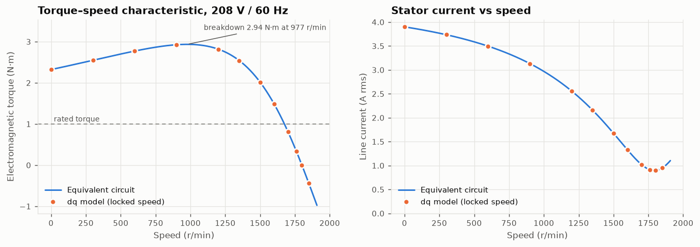

# Induction Motor VFD Simulator — resumen en español

[](https://github.com/julianS-eng/induction-motor-vfd-sim/actions/workflows/ci.yml)
[](LICENSE)
[](pyproject.toml)

**Gemelo digital de un variador de frecuencia (VFD) que alimenta un motor de inducción jaula de
ardilla**: modelo dinámico dq de la máquina, cargas mecánicas, etapa de potencia, control escalar
V/f y, en fases posteriores, control vectorial (FOC), control sin sensor y un núcleo de control
en C ejecutado en *software-in-the-loop*.

La documentación técnica completa (teoría con ecuaciones, diagrama de bloques, resultados y
gráficas) está en inglés en el [README principal](README.md). La guía de estudio en español,
con la teoría paso a paso, las decisiones de diseño y preguntas de entrevista, está en
[docs/LEARNING.md](docs/LEARNING.md).

## Motivación

El proyecto acompaña una tesis de pregrado que es una **guía didáctica para implementar un
variador de velocidad en un motor jaula de ardilla con carga, usando equipos LabVolt / Festo**.
El simulador permite predecir cada experimento antes de ir al banco, explicar los fenómenos
(pérdida de par a baja velocidad, necesidad del *boost* y de la compensación de deslizamiento,
límite de tensión del modulador) y sintonizar controladores con la misma temporización que un
microcontrolador.

## Estado por fases

| Fase | Alcance | Estado |
|---|---|---|
| 1 | Modelo dq, cargas, inversor promediado con SPWM, V/f con rampa, boost y compensación de deslizamiento, tests físicos | ✅ terminada |
| 2 | Rectificador de diodos, bus DC, chopper de frenado, inversor conmutado con tiempos muertos, SVPWM, comparación SPWM vs SVPWM | ⏳ |
| 3 | FOC indirecto con lazos PI de corriente y velocidad, sintonía documentada, comparación arranque directo / V/f / FOC | ⏳ |
| 4 | FOC sin sensor con observador MRAS | ⏳ |
| 5 | Núcleo de control en C99 llamado con `ctypes` (SIL), notas de portabilidad a ESP32-S3 (MCPWM) | ⏳ |
| 6 | Identificación del circuito equivalente desde CSV, dashboard Streamlit, documentación final | ⏳ |

## Resultados principales de la Fase 1

Todos los números se generan con `vfdsim experiments phase1` y se inyectan en el README con
`scripts/sync_readme.py` (la CI verifica que estén sincronizados). Con el motor **supuesto** de
175 W, 208 V, 60 Hz, 4 polos:

* **Validación del modelo**: la velocidad en vacío coincide con $n_s = 120 f / P$ (error relativo
  del orden de $10^{-8}$); el par del modelo dq con el eje bloqueado coincide con el circuito
  equivalente en 12 puntos con error máximo de $1.3\times10^{-5}$ N·m; el balance de potencia
  cierra con residuo relativo del orden de $10^{-7}$.
* **Límite del modulador**: con un bus de 285 V (puente de diodos desde 208 V) la SPWM entrega
  como máximo 174.5 V de línea, por lo que la ley V/f se satura en 49.75 Hz y a 60 Hz el par
  máximo cae a 2.07 veces el nominal.
* **Compensación de deslizamiento**: a 30 Hz y par nominal el error de velocidad baja de
  13.43 % a 1.03 %.
* **Boost**: con 50 % de carga y sin boost el motor se detiene por debajo de unos 5 Hz; con 6 % de
  boost sigue girando a 2 Hz.



## Uso rápido

```bash
pip install -e ".[dev]"
vfdsim info                      # datos del motor y punto nominal
vfdsim simulate --t-end 3        # escenario configs/default.yaml
vfdsim experiments phase1        # regenera figuras y tablas
pytest                           # tests
```

## Datos del motor

Todos los parámetros de `configs/motors/educational_175w_4pole.yaml` son **supuestos** típicos de
un motor didáctico de 0.2 kW y están marcados con `provenance: assumed`. Para modelar el motor
real del banco basta copiar el archivo, reemplazar la placa, el circuito equivalente
identificado (ensayos DC, vacío y rotor bloqueado) y la inercia/fricción (ensayo de
desaceleración libre), y cambiar la procedencia a `nameplate` / `measured` / `identified`.

## Relación con el banco LabVolt / Festo

Cada bloque del simulador corresponde a un módulo del banco: motor jaula de ardilla de cuatro
polos, fuente trifásica de 208 V, rectificador con condensadores de filtro, módulo
chopper/inversor IGBT, dinamómetro de cuatro cuadrantes (modos de par constante, ventilador,
fricción y volante de inercia) e interfaz de adquisición de datos. La tabla completa y el flujo
de trabajo sugerido para la guía están en la sección
[*Connection with the LabVolt / Festo bench*](README.md#connection-with-the-labvolt--festo-bench).

## Licencia

[MIT](LICENSE)
