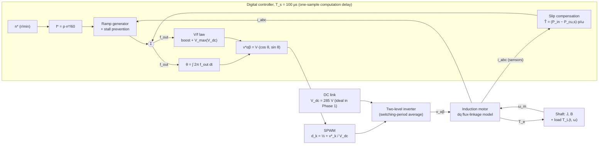
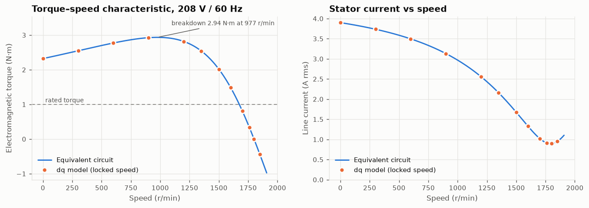
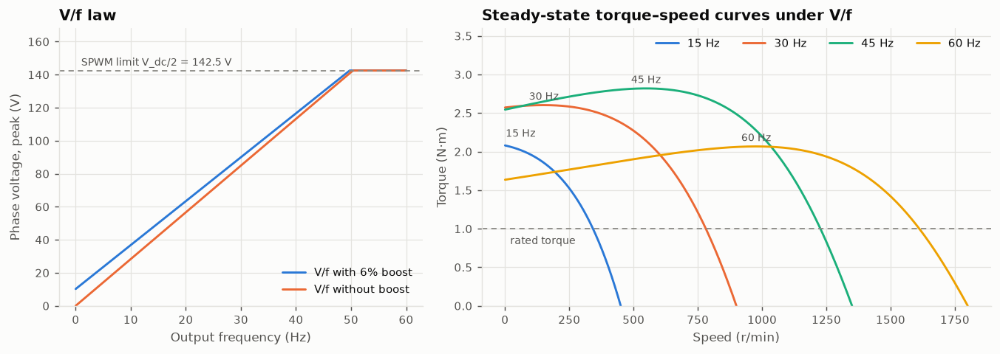
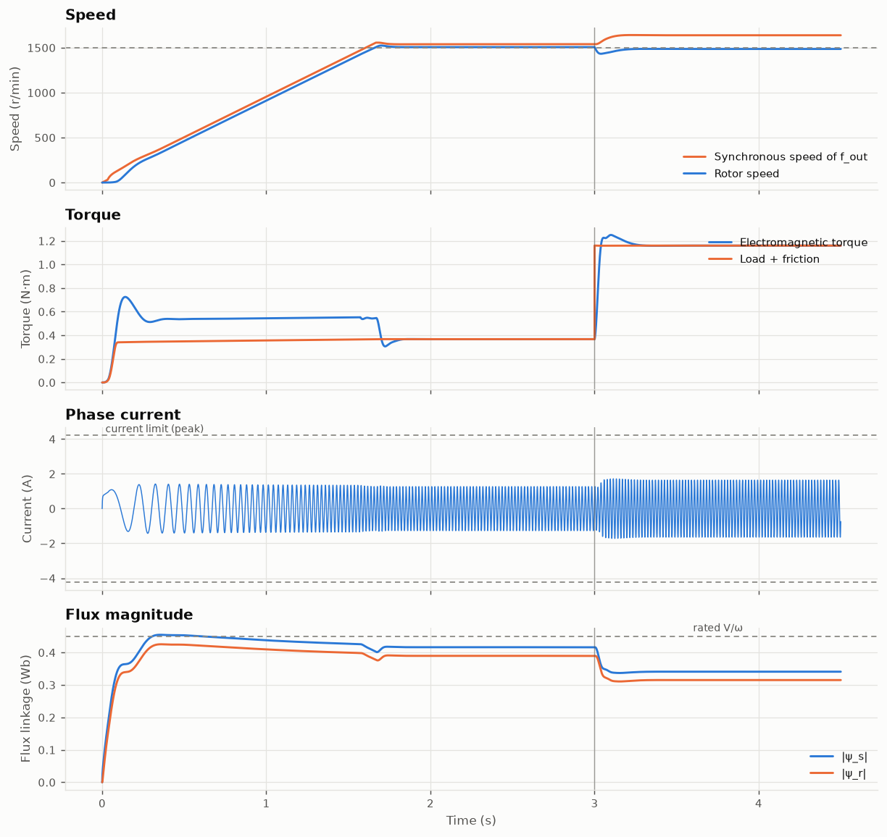
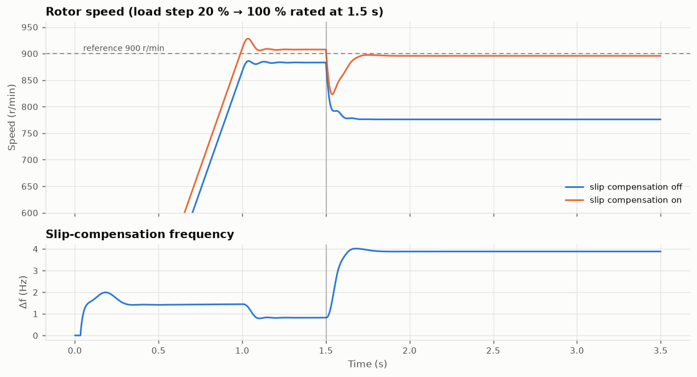
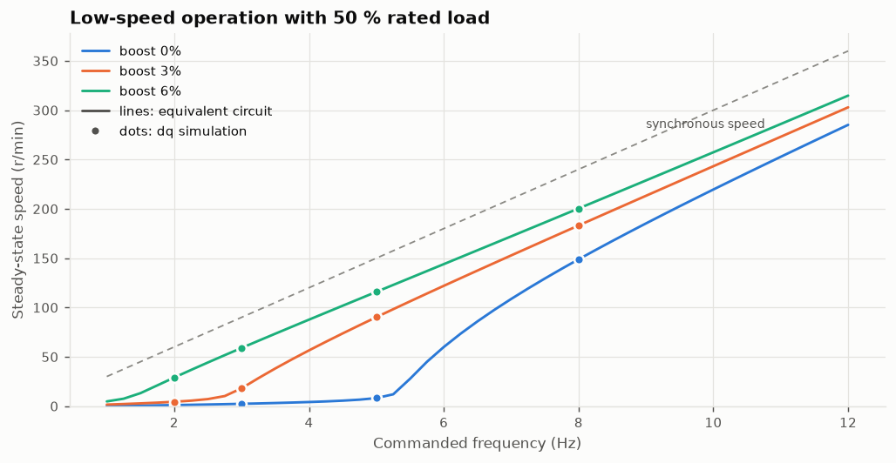

# Induction Motor VFD Simulator

[](https://github.com/julianS-eng/induction-motor-vfd-sim/actions/workflows/ci.yml)
[](LICENSE)
[](pyproject.toml)
[](https://docs.astral.sh/ruff/)
[](https://mypy-lang.org/)

A **digital twin of a variable-frequency drive (VFD) feeding a squirrel-cage induction
motor**: a dynamic dq model of the machine, mechanical loads, the power stage, scalar V/f
control and (in later phases) field-oriented and sensorless control, together with an
embedded C control core exercised in software-in-the-loop.

> **Branch `labvolt-8221-22`**: copy of the project configured with the laboratory motor
> (LabVolt 8221-22, 200 W, 208 V, 60 Hz, 1685 r/min). The `main` branch keeps the generic
> assumed 175 W motor.

> 🇪🇸 Resumen en español: [README.es.md](README.es.md) · Guía de estudio: [docs/LEARNING.md](docs/LEARNING.md)

---

## Contents

1. [Motivation](#motivation)
2. [Project status and roadmap](#project-status-and-roadmap)
3. [Quick start](#quick-start)
4. [Architecture](#architecture)
5. [Theory](#theory)
6. [Phase 1 results: plant and V/f control](#phase-1-results-plant-and-vf-control)
7. [Connection with the LabVolt / Festo bench](#connection-with-the-labvolt--festo-bench)
8. [Motor data: LabVolt 8221-22](#motor-data-labvolt-8221-22)
9. [Known limitations and future work](#known-limitations-and-future-work)
10. [Repository layout](#repository-layout) · [Development](#development) · [License](#license)

## Motivation

This project supports an undergraduate thesis that is a **didactic guide to implementing a
variable-speed drive for a loaded squirrel-cage induction motor on LabVolt / Festo training
equipment**. Laboratory time on a real bench is limited and mistakes are expensive (tripped
protections, overheated windings, stalled motors). A simulator that mirrors the bench makes it
possible to:

* predict what each experiment should show before touching the hardware;
* explain *why* a V/f drive loses torque at low speed, why slip compensation is needed or why
  a sine-triangle modulator cannot reach the rated voltage from a rectified 208 V grid;
* tune controllers (V/f, and later FOC and sensorless schemes) safely, with the same timing
  as a microcontroller;
* compare measured and simulated waveforms to validate the identified motor parameters.

It is built as an engineering product: typed, tested against first principles, configured
through YAML, reproducible (fixed seeds, every figure and number generated by scripts), and
continuously integrated.

## Project status and roadmap

| Phase | Scope | Status |
|---|---|---|
| 1 | dq motor model, loads, averaged SPWM inverter, V/f with ramp, boost and slip compensation, physics tests | ✅ done |
| 2 | Diode rectifier, DC-link capacitor, braking chopper, switched two-level inverter with dead time, SVPWM, SPWM vs SVPWM (DC-bus utilisation, THD by FFT, dead-time effects) | ⏳ planned |
| 3 | Indirect FOC: Clarke/Park, d/q current PI loops, cascaded speed loop, decoupling, anti-windup, current limits, documented tuning; DOL vs V/f vs FOC | ⏳ planned |
| 4 | Sensorless FOC with an MRAS speed observer, low-speed degradation and parameter sensitivity | ⏳ planned |
| 5 | Portable C99 control core (Clarke/Park, PI, SVPWM, V/f) called through `ctypes` at a fixed sample rate; ESP32-S3 MCPWM portability notes | ⏳ planned |
| 6 | Equivalent-circuit identification from no-load / locked-rotor CSV data, Streamlit dashboard, final documentation | ⏳ planned |

## Quick start

```bash
git clone https://github.com/julianS-eng/induction-motor-vfd-sim.git
cd induction-motor-vfd-sim
python -m venv .venv && source .venv/bin/activate
pip install -e ".[dev]"

vfdsim info                                  # motor data, derived quantities, rated point
vfdsim simulate --t-end 3 --plot out/run.png # run configs/default.yaml (V/f start)
vfdsim experiments phase1                    # regenerate docs/img/phase1_* and docs/results/phase1.*
pytest                                       # full test suite (~20 s)
```

Programmatic use:

```python
from vfdsim.config import default_config
from vfdsim.control import PiecewiseConstant
from vfdsim.mechanics import CompositeLoad, ConstantTorqueLoad, InertiaLoad
from vfdsim.scenarios import build_vf_simulator

cfg = default_config()  # configs/default.yaml + LabVolt 8221-22 motor
load = CompositeLoad((InertiaLoad(1e-3), ConstantTorqueLoad(0.8)))
sim = build_vf_simulator(
    cfg, load=load, speed_reference_rpm=PiecewiseConstant(((0.0, 1500.0), (2.5, 900.0)))
)
res = sim.run(4.0)
print(res.speed_rpm[-1], res["torque_e"][-1], res["ctrl.f_out_hz"][-1])
```

## Architecture



The simulation engine reproduces the timing of a digital drive. At every sampling instant
`t_k = k·T_s` the sensors are read, the controller computes a voltage reference, the modulator
turns it into duty cycles, and those duties are applied during the *next* period (the one-sample
delay of an MCU that writes its PWM registers for the next carrier period). The power stage
splits each period into segments of constant pole state and the continuous plant is integrated
through them with a fixed-step RK4. The same interface will host the switched inverter with
dead time (Phase 2) and the C control core (Phase 5).

The plant state includes **energy accumulators** (input energy, copper losses, electromagnetic
work, load work, friction) integrated together with the physical states, so power balances are
verified to integration accuracy rather than from sampled waveforms.

## Theory

### Space vectors and reference frames

Three-phase quantities are represented with the amplitude-invariant Clarke transform

$$
x_\alpha = \tfrac{2}{3}\left(x_a - \tfrac{1}{2}x_b - \tfrac{1}{2}x_c\right),\qquad
x_\beta = \tfrac{1}{\sqrt{3}}\left(x_b - x_c\right),
$$

so that the length of the space vector equals the phase peak value and the instantaneous
power is $p = \tfrac{3}{2}(v_\alpha i_\alpha + v_\beta i_\beta)$. The Park transform rotates
this vector into a frame at angle $\theta$: $x_{dq} = e^{-j\theta}x_{\alpha\beta}$.

### Dynamic model of the squirrel-cage machine

With stator and rotor flux linkages as states, in the stationary frame (rotor quantities
referred to the stator, $\omega_r = p\,\omega_m$ electrical rotor speed):

$$
\frac{d\underline{\psi}_s}{dt} = \underline{v}_s - R_s\,\underline{i}_s, \qquad
\frac{d\underline{\psi}_r}{dt} = -R_r\,\underline{i}_r + j\,\omega_r\,\underline{\psi}_r,
$$

$$
\begin{bmatrix}\underline{\psi}_s\\ \underline{\psi}_r\end{bmatrix} =
\begin{bmatrix}L_s & L_m\\ L_m & L_r\end{bmatrix}
\begin{bmatrix}\underline{i}_s\\ \underline{i}_r\end{bmatrix},\qquad
L_s = L_{ls} + L_m,\; L_r = L_{lr} + L_m .
$$

Electromagnetic torque and mechanics:

$$
T_e = \tfrac{3}{2}\,p\,(\psi_{s\alpha} i_{s\beta} - \psi_{s\beta} i_{s\alpha}),\qquad
J\,\frac{d\omega_m}{dt} = T_e - T_L(t,\omega_m) - B\,\omega_m .
$$

### Steady state: equivalent circuit, synchronous speed and slip

In sinusoidal steady state the model reduces to the per-phase T-equivalent circuit
($R_s$, $jX_{ls}$, $jX_m$, $jX_{lr}$, $R_r/s$). The field rotates at the synchronous speed

$$
n_s = \frac{120\,f}{P}\ \text{r/min}, \qquad s = \frac{n_s - n}{n_s},
$$

and the torque follows from the air-gap power, $T_e = \dfrac{3\,|I_r'|^2 R_r/s}{\omega_s/p}$.
With the Thevenin equivalent $V_{th}, Z_{th} = R_{th} + jX_{th}$ seen by the rotor branch,
the breakdown point is

$$
s_{max} = \frac{R_r}{\sqrt{R_{th}^2 + (X_{th} + X_{lr})^2}},\qquad
T_{max} = \frac{3\,V_{th}^2}{2\,\tfrac{\omega_s}{p}\left(R_{th} + \sqrt{R_{th}^2 + (X_{th}+X_{lr})^2}\right)} .
$$

Power flow: $P_{in} = P_{cu,s} + P_{ag}$, $P_{cu,r} = s\,P_{ag}$,
$P_{mech} = (1-s)\,P_{ag}$.

### Scalar V/f control

Neglecting $R_s$, the stator flux is $\psi_s \approx \hat V_s/\omega_e$: keeping V/f constant
keeps the flux, and therefore the torque capability, constant. The implemented law is

$$
\hat V(f) = V_0 + (\hat V_b - V_0)\,\min\!\left(\frac{|f|}{f_b}, 1\right)^{k},\qquad k = 1\ \text{(linear) or}\ 2\ \text{(quadratic)},
$$

where the **boost** $V_0$ compensates the $R_s i_s$ drop that dominates at low frequency, and
$\hat V$ is clamped to the modulator limit (field weakening beyond it). The frequency set-point
passes through a **ramp** (acceleration/deceleration rates) that is held while the filtered
current exceeds a limit (**stall prevention**). **Slip compensation** estimates the air-gap
torque from the power the drive already knows and adds the corresponding slip frequency:

$$
\hat T = \frac{p}{\omega_e}\left(\tfrac{3}{2}\,\underline{v}_s\cdot\underline{i}_s - \tfrac{3}{2}R_s|\underline{i}_s|^2\right),\qquad
\Delta f = K\, s_r f_r\,\frac{\hat T}{T_r}\,\frac{1}{(\psi/\psi_r)^2} .
$$

The voltage vector used in the estimate is rotated by $(0.5 + d)\,\omega_e T_s$ to account for
the zero-order hold and the $d$-sample computation delay; without this alignment the power
estimate is biased, because the power factor of a small motor is low and
$P = VI\cos\varphi$ is then very sensitive to phase errors.

### Sinusoidal PWM (averaged)

Each leg compares its reference with a triangular carrier. Over a switching period the pole
voltage equals $d_k V_{dc}$ with $d_k = \tfrac{1}{2} + v_k^*/V_{dc}$, so the linear range ends
at $\hat V_{ph} = V_{dc}/2$, i.e. a line voltage of $\tfrac{\sqrt{3}}{2\sqrt{2}}V_{dc} = 0.612\,V_{dc}$ rms.
For the 285 V bus of a diode bridge fed from 208 V this is 174.5 V < 208 V: **with SPWM the
drive cannot apply rated voltage and the V/f law (12 % boost) saturates at 49.25 Hz**. SVPWM (Phase 2)
raises the limit by 15.5 %.

## Phase 1 results: plant and V/f control

All numbers below are generated by `vfdsim experiments phase1` (source:
[`src/vfdsim/experiments/phase1.py`](src/vfdsim/experiments/phase1.py)) and injected into this
README by [`scripts/sync_readme.py`](scripts/sync_readme.py); CI fails if they drift apart.
The motor is the **LabVolt 8221-22** of the thesis laboratory,
[`configs/motors/labvolt_8221_22.yaml`](configs/motors/labvolt_8221_22.yaml): real rating plate,
equivalent circuit fitted to that plate (see [Motor data](#motor-data-labvolt-8221-22)), assumed
inertia and friction.

<!-- BEGIN results/phase1.md -->
#### Model validation summary

| Check | Result |
|---|---|
| No-load speed vs 120·f/P (45 Hz, frictionless) | 1,350.000 vs 1,350.000 r/min (error 8.8e-09) |
| dq torque vs equivalent circuit (12 locked-speed points) | max abs(ΔT) = 2.8e-07 N·m |
| dq current vs equivalent circuit | max relative error 1.9e-04 |
| Steady-state power balance (45 Hz, rated load) | relative residual -2.6e-07 |
| Energy conservation over a 4.5 s start + load step | relative residual -4.7e-07 |

#### Motor LabVolt-8221-22-200W-4p-208V-60Hz: rated operating point (equivalent circuit, 208 V / 60 Hz)

| Quantity | Value | Rating plate (nameplate) |
|---|---|---|
| Speed | 1,685.0 r/min | 1,685 r/min |
| Slip | 6.39 % | 6.39 % |
| Shaft power | 200.0 W | 200 W |
| Line current | 1.140 A | 1.14 A |
| Power factor | 0.730 | - |
| Efficiency (no core loss) | 66.7 % | - |
| No-load current | 0.925 A | - |
| Breakdown torque / slip | 2.267 N·m (2.00× rated) at s = 0.320 | - |
| Locked-rotor current / torque | 3.73 A / 1.587 N·m | - |

#### Torque capability under V/f (equivalent circuit, 12% boost, 285 V bus, SPWM)

| Frequency | Applied line voltage | Breakdown torque | vs rated |
|---|---|---|---|
| 15 Hz | 70.7 V | 1.080 N·m | 0.95× |
| 30 Hz | 116.5 V | 1.528 N·m | 1.35× |
| 45 Hz | 162.2 V | 1.924 N·m | 1.70× |
| 60 Hz | 174.5 V | 1.596 N·m | 1.41× |

The SPWM voltage limit is reached at 49.25 Hz: above it the drive can no longer hold V/f constant and the machine is under-fluxed.

#### V/f steady state at rated load torque

| f / reference (r/min) | Applied V (peak, phase) | Stator flux | Speed, no slip comp. (slip) | Current (dq / eq. circuit) | Speed with slip comp. (f_out) |
|---|---|---|---|---|---|
| 15 Hz / 450 | 57.7 V | 0.194 Wb | 5.4 (98.80 %) | 1.455 / 1.455 A | 6.4 (18.34 Hz) |
| 30 Hz / 900 | 95.1 V | 0.374 Wb | 776.0 (13.78 %) | 1.134 / 1.134 A | 895.7 (33.89 Hz) |
| 45 Hz / 1350 | 132.5 V | 0.387 Wb | 1,233.3 (8.64 %) | 1.136 / 1.136 A | 1,351.4 (48.91 Hz) |
| 60 Hz / 1800 | 142.5 V | 0.303 Wb | 1,602.8 (10.95 %) | 1.222 / 1.221 A | 1,602.8 (60.00 Hz) |

#### Power balance at 45 Hz, rated load (averages over 0.5 s of steady state)

| Term | Power |
|---|---|
| Electrical input P_in | 243.30 W |
| Stator copper loss | 79.96 W |
| Rotor copper loss | 14.12 W |
| Motor bearing friction | 2.84 W |
| Delivered to the load | 146.39 W |
| Residual P_in − Σ | -6.4e-05 W (-2.6e-07 of P_in) |
| Efficiency (no core loss) | 60.2 % |

#### V/f start to 1500 r/min (30 % rated load, +70 % load step at 3 s, slip compensation on)

| Metric | Value |
|---|---|
| Time to 95 % of reference speed | 1.572 s |
| Peak phase current | 1.719 A |
| Speed before / after load step | 1,507.1 / 1,486.1 r/min |
| Minimum speed after the step | 1,432.5 r/min |
| Energy balance residual (electrical / mechanical) | -4.7e-07 / -1.2e-10 (relative) |

#### Slip compensation at 900 r/min (30 Hz)

| Slip compensation | Speed at 20 % load (error) | Speed at 100 % load (error) |
|---|---|---|
| off | 883.2 r/min (-1.87 %) | 776.0 r/min (-13.78 %) |
| on | 907.6 r/min (0.85 %) | 895.7 r/min (-0.48 %) |

#### Voltage boost at low frequency (30 % rated load, slip compensation off)

| Boost | Speed at 2 Hz (sync 60) | Speed at 3 Hz (sync 90) | Speed at 5 Hz (sync 150) | Speed at 8 Hz (sync 240) | Stator flux at 2 Hz |
|---|---|---|---|---|---|
| 0% | 0.3 | 0.8 | 2.0 | 4.4 | 0.076 Wb |
| 6% | 2.6 | 4.5 | 67.0 | 193.8 | 0.211 Wb |
| 12% | 23.5 | 58.1 | 123.4 | 216.5 | 0.373 Wb |

Speeds in r/min from the dq simulation. Without boost the stator resistance drop leaves too little flux and the motor stalls (speed ≈ 0). For reference, the rated flux is about 0.450 Wb (V/ω at the rating plate).
<!-- END results/phase1.md -->

### Torque–speed characteristic: dq model vs equivalent circuit

The dq model is run with the shaft held at fixed speeds (a dynamometer in speed mode) and the
steady-state average torque and RMS current are compared with the analytical equivalent
circuit. The two independent formulations agree to better than $10^{-6}$ N·m.



### V/f law and the resulting torque capability

Left: the commanded voltage with and without boost, clamped by the SPWM limit
$V_{dc}/2$. Right: steady-state torque–speed curves under that law. This motor has a large
stator resistance (≈ 20.7 Ω, fitted to the plate), so even with a 12 % boost the flux drops at
low frequency: the breakdown torque is only 0.95× rated at 15 Hz, 1.35× at 30 Hz and 1.70× at
45 Hz; at 60 Hz the bus-voltage limit brings it down to 1.41× rated. **In the lab, V/f operation
at rated torque below about 20 Hz should not be expected with this motor** (the 15 Hz row of the
steady-state table stalls).



### Start-up and load step under V/f

Ramp start to 1500 r/min with 30 % load and a +70 % load step at 3 s. The flux builds up during
the first 0.1 s, the speed follows
the ramp with a small slip, and slip compensation restores the speed after the load step by
raising the output frequency.



### Slip compensation

Without compensation the speed error equals the slip (13.78 % at rated load and 30 Hz); the
compensated drive stays within about 1 % (−0.48 % at rated load, +0.85 % at 20 % load). The
residual error comes from the linear slip–torque approximation of the nameplate-based model.
The transient spike of Δf during acceleration is the estimator reacting to the accelerating
torque.



### Boost at low frequency

With 30 % rated load and no boost the motor stalls at every frequency up to 8 Hz; a 12 % boost
keeps it running down to 2 Hz (with large slip). Lines are the equivalent-circuit prediction
and dots the time-domain simulation of the complete drive.



## Connection with the LabVolt / Festo bench

The simulator is organised so that each block maps onto a module of a LabVolt / Festo
electromechanical training bench (0.2 kW series). Model numbers are given for orientation;
check the inventory of your laboratory.

| Simulator block | Bench equivalent | What to measure / configure |
|---|---|---|
| `nameplate` in the motor YAML | Four-pole squirrel-cage induction motor LabVolt 8221-22 (three 120 V windings, terminals 1-4, 2-5, 3-6, connected in star for 208 V) | Rating plate: power, voltage, current, frequency, speed, connection |
| `equivalent_circuit` | Same motor, no-load and locked-rotor tests with the three-phase supply and the data-acquisition interface | $R_s$ by DC test; $X_m$ from no-load; $R_r$, $X_{ls}+X_{lr}$ from locked rotor (automated in Phase 6) |
| `mechanical` (J, B) | Motor + timing belt + dynamometer rotor | Coast-down test: $J\,d\omega/dt = -(B\omega + T_c)$ |
| `load` components (`constant`, `quadratic`, `friction`, `step`, `inertia`) | Four-quadrant dynamometer / power supply in torque, fan/pump, friction or flywheel mode | Load torque set-point and mode |
| `dc_link` | Three-phase diode rectifier + filtering capacitors fed from the 208 V supply | DC-bus voltage ($\sqrt{2}\cdot 208 \approx 294$ V at no load; 285 V assumed under load) |
| `inverter`, `modulation` | IGBT chopper/inverter module driven by the controller | Switching frequency, dead time, modulation method |
| `vf_control` / later FOC | Controller (drive firmware, or an external MCU such as the ESP32-S3 of Phase 5) | Ramp rates, boost, slip compensation, limits |
| Recorded signals (`i_abc`, `ω_m`, `T_e`, `v_dc`) | Data-acquisition and control interface, current/voltage isolators, speed/torque from the dynamometer | Waveforms and metering to compare with the simulation |

Suggested workflow for the guide:

1. **Before the lab**: enter the rating plate in a copy of the motor YAML, run
   `vfdsim info` and predict the rated point, breakdown torque and starting current.
2. **Identification**: perform the DC, no-load and locked-rotor tests; replace the plate-fitted
   equivalent circuit with the identified one; repeat a coast-down test for J and B.
3. **V/f experiments**: reproduce the figures of this section on the bench (start-up with
   the dynamometer as constant-torque load, load step, low-frequency operation with and without
   boost, slip compensation) and overlay the measured and simulated curves.
4. **Discuss the discrepancies**: core losses, saturation and temperature (see the
   limitations below) are the usual suspects.

> Safety: the simulator does not replace the laboratory's safety procedures. Always respect
> the current and voltage ratings of the modules and use the bench protections.

## Motor data: LabVolt 8221-22

The default motor file [`configs/motors/labvolt_8221_22.yaml`](configs/motors/labvolt_8221_22.yaml)
holds the rating plate of the laboratory motor (208 V 3~ 60 Hz; motor mode 200 W, PF 0.73,
1685 r/min, 1.14 A; generator mode 200 W, PF 0.47, 1900 r/min, 1.18 A; three 120 V windings;
10 kΩ thermistor). The plate does not give the equivalent circuit, so
[`scripts/fit_nameplate.py`](scripts/fit_nameplate.py) fits $R_s$, $R_r$, $L_{ls}=L_{lr}$ and
$L_m$ so that the circuit reproduces the motor-mode point exactly, with an **assumed** breakdown
torque of 2.0× rated. The generator-mode point is used as an independent check:

<!-- BEGIN results/labvolt_fit.md -->
#### LabVolt 8221-22: equivalent circuit fitted to the rating plate

| Parameter | Value |
|---|---|
| R_s | 20.650 Ω |
| R_r | 8.194 Ω |
| L_ls = L_lr | 21.55 mH |
| L_m | 318.6 mH |
| Breakdown torque | 2.267 N·m at s = 0.320 (assumed 2.0× rated) |

| Mode | Power (plate / model) | PF (plate / model) | Current (plate / model) |
|---|---|---|---|
| Motor (1685 r/min) | 200 W / 200.0 W | 0.73 / 0.730 | 1.14 A / 1.140 A |
| Generator (1900 r/min) | 200 W / 199.6 W | 0.47 / 0.402 | 1.18 A / 1.378 A |

The motor point is fitted exactly. The generator point is a validation: the model delivers the plate power but with a lower power factor and higher current, because it has no iron-loss branch and no saturation.
<!-- END results/labvolt_fit.md -->

Provenance in the YAML: `nameplate: nameplate`, `equivalent_circuit: identified` (from the plate,
not from tests) and `mechanical: assumed` (J and B), so `vfdsim info` still warns about the
mechanical data. The previous generic motor (`educational_175w_4pole.yaml`, all values assumed)
is kept for comparison. To refine the model, replace the circuit with the one identified from
the DC, no-load and locked-rotor tests, and J/B with a coast-down test.

The V/f boost was raised from 6 % to **12 %** in `configs/default.yaml` because of the large
fitted $R_s$: with 6 % the motor stalls at 30 Hz under rated load.

## Known limitations and future work

Phase 1 deliberately documents what is *not* modelled yet:

* **Magnetic saturation** is not modelled ($L_m$ constant); a real machine would draw a higher
  magnetising current wherever the boost pushes the flux above rated. *Future work*: a saturable $L_m(\lvert\psi_m\rvert)$ from no-load data.
* **Core (iron) losses** are neglected (no $R_c$ branch). Because the plate efficiency (≈ 67 %)
  must be reproduced, the fit attributes all losses to copper, which inflates $R_s$; this is also
  why the generator-mode power factor and current do not match the plate. *Future work*: parallel $R_c$ identified
  from the no-load test (Phase 6 will at least report it).
* **Temperature** dependence of $R_s$, $R_r$ and **deep-bar / skin effect** in the rotor are
  not modelled.
* The **DC bus is ideal and the inverter is averaged** (no ripple, no dead time, no device
  drops) — addressed in Phase 2.
* Sensors are ideal except for optional white noise on the currents; encoder quantisation and
  ADC resolution arrive with Phases 3–5.
* V/f slip compensation uses the nameplate slip and a linear torque–slip model: expect errors
  of about 1 % (quantified above).
* The equivalent circuit comes from the rating plate plus an assumed 2.0× breakdown torque,
  not from measurements.

## Repository layout

```
configs/                    YAML scenarios; motors/ holds motor data files
src/vfdsim/
  motor/                    parameters, dq model, equivalent circuit
  mechanics/                load models
  power/                    grid source, inverter models
  modulation/               SPWM (SVPWM in Phase 2)
  control/                  ramp, references, V/f controller
  simulation/               plant (with energy bookkeeping), RK4, engine, results
  experiments/              scripts that generate docs/img and docs/results
  config.py, scenarios.py, cli.py, plotting.py, transforms.py
tests/                      unit + physics validation tests
docs/                       figures, generated result tables, LEARNING.md (Spanish)
scripts/sync_readme.py      injects docs/results/*.md into this README
```

## Development

```bash
pip install -e ".[dev]"
ruff check . && ruff format --check .   # lint + format
mypy                                    # strict typing (src and tests)
pytest                                  # all tests (use -m "not slow" to skip the experiment smoke test)
vfdsim experiments phase1 && python scripts/sync_readme.py   # regenerate figures and README tables
```

Commits follow [Conventional Commits](https://www.conventionalcommits.org/). Results are
deterministic: simulations are fixed-step and random noise uses fixed seeds from the YAML.

## License

[MIT](LICENSE)
